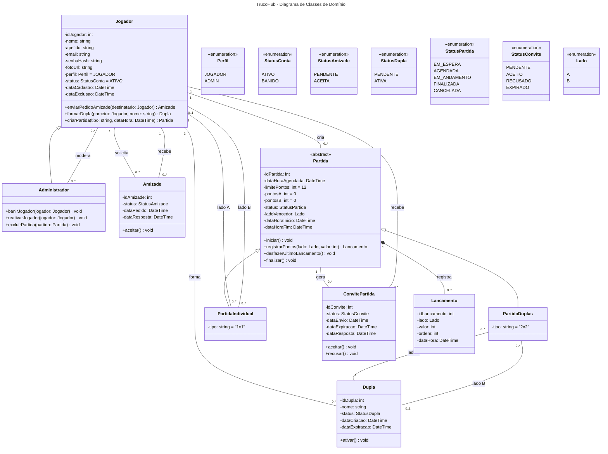
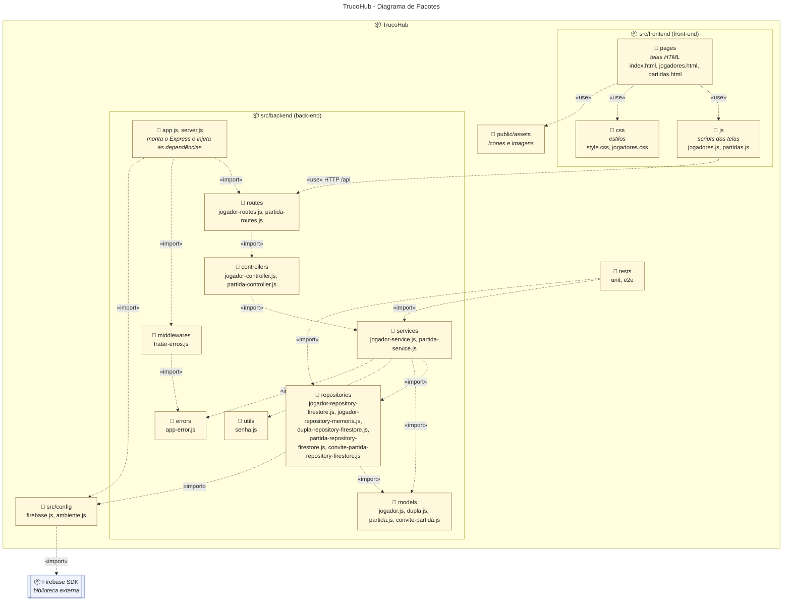

# Diagramas de design do TrucoHub (Sprint 2)

Diagramas do item #19 (classes de domínio e pacotes) da Sprint 2.

## Índice

| Arquivo | Diagrama | Item |
|---|---|---|
| [01-classes-dominio](#01-classes-dominio) | Diagrama de Classes de Domínio | #19 |
| [02-pacotes](#02-pacotes) | Diagrama de Pacotes (front-end e back-end) | #19 |

## Decisões de modelagem

- **Base:** o dicionário de dados do [Documento de Requisitos](../requisitos/Documento_de_Requisitos_TrucoHub.pdf) (capítulo 5) e a estrutura de pastas do README.
- **Administrador:** `Administrador` herda de `Jogador`, porque todo administrador também é um jogador, com as mesmas informações e funcionalidades e mais as de moderação (RF024 e RF025). No banco não existe tabela separada: é a mesma coleção `jogadores`, e o campo `perfil` (`JOGADOR` ou `ADMIN`) indica qual é o caso, como no dicionário de dados.
- **Herança de partida:** `PartidaDuplas` (2×2) e `PartidaIndividual` (1×1) herdam de `Partida` (no banco, uma só coleção `partidas`, com o campo `tipo`).
- **Camadas do back-end:** `routes` → `controllers` → `services` → `repositories` → Firestore, com `models` (entidades e regras de formato) e `utils` (hash scrypt da senha). Os nomes dos arquivos seguem o padrão kebab-case do CRUD de Jogador (#24).
- **CRUD de 1 tabela:** Jogador (RF002 a RF005). A exclusão é lógica: preenche `data_exclusao`.
- **CRUD de 3 tabelas:** Partida, com Dupla e Jogador (RF012 a RF015). `convite_partida` aparece como tabela intermediária.

## Diagrama de Classes de Domínio

PNG: [imagens/01-classes-dominio.png](imagens/01-classes-dominio.png)

## Diagrama de Pacotes (front-end e back-end)

PNG: [imagens/02-pacotes.png](imagens/02-pacotes.png)

