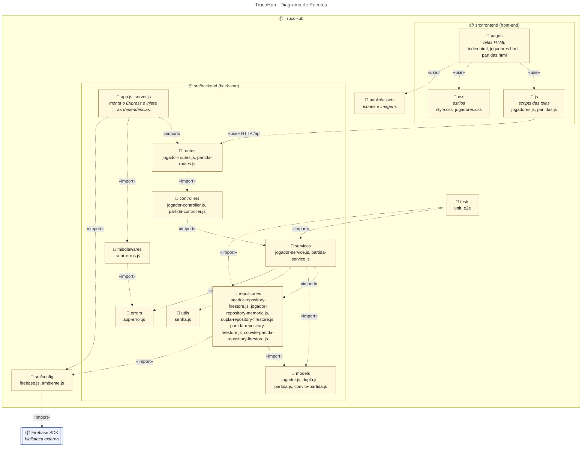
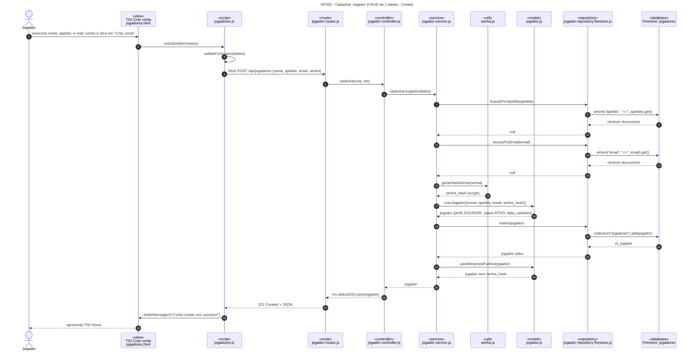
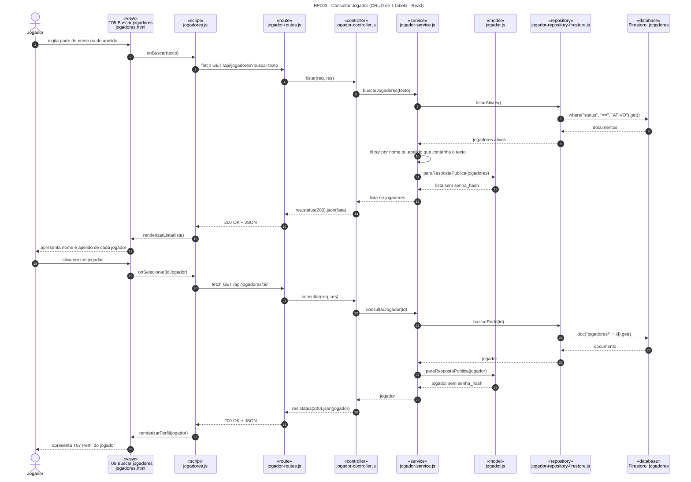
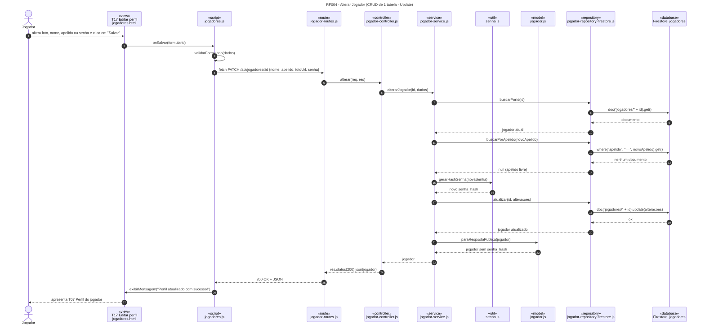
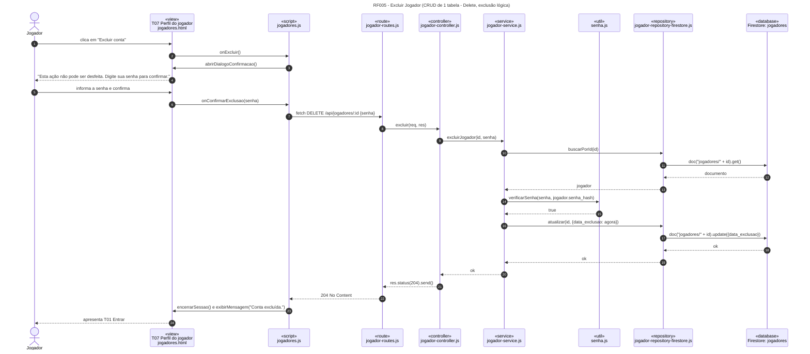
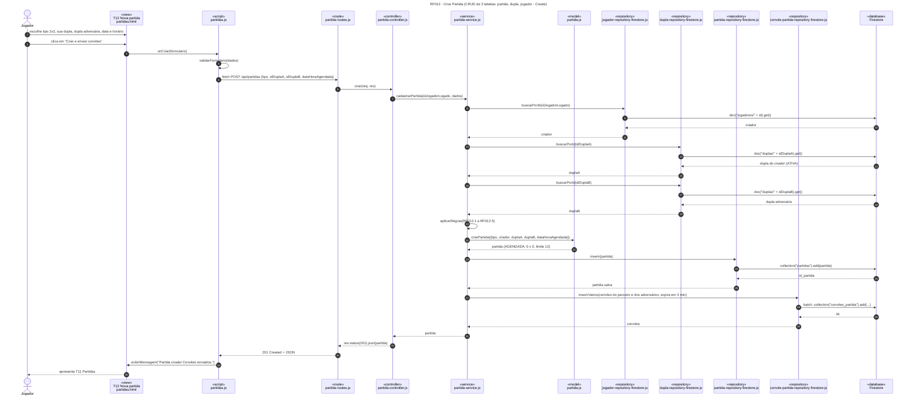
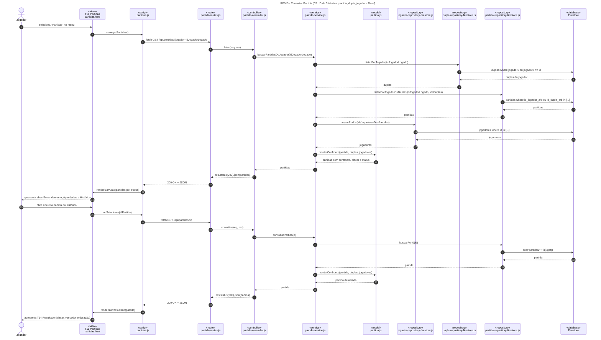
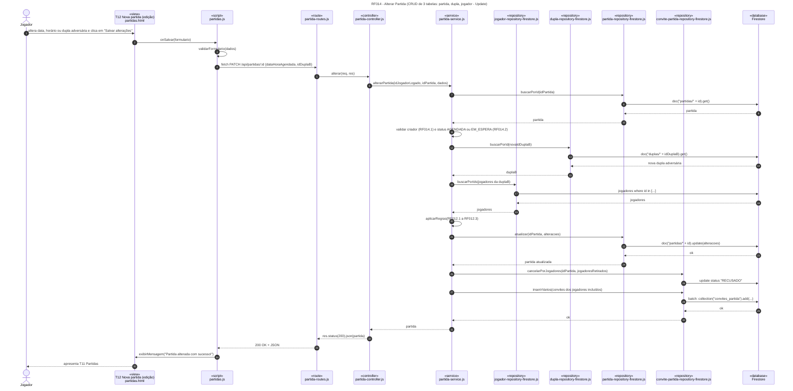
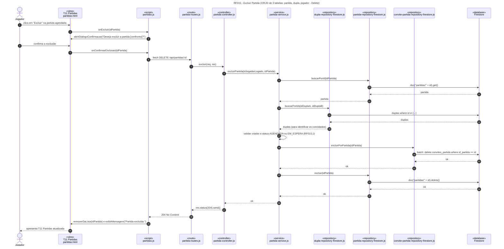
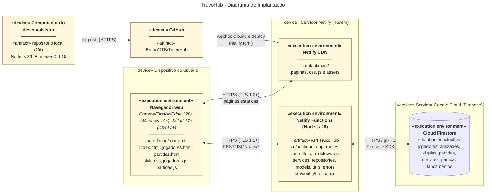

# Diagramas de design do TrucoHub (Sprint 2)

Diagramas dos itens #19 (classes de domínio e pacotes), #20 (sequência) e #25 (implantação) da Sprint 2.

## Índice

| Arquivo | Diagrama | Item |
|---|---|---|
| [01-classes-dominio](#01-classes-dominio) | Diagrama de Classes de Domínio | #19 |
| [02-pacotes](#02-pacotes) | Diagrama de Pacotes (front-end e back-end) | #19 |
| [03-seq-cadastrar-jogador](#03-seq-cadastrar-jogador) | Sequência: RF002 Cadastrar Jogador (CRUD 1 tabela, C) | #20 |
| [04-seq-consultar-jogador](#04-seq-consultar-jogador) | Sequência: RF003 Consultar Jogador (CRUD 1 tabela, R) | #20 |
| [05-seq-alterar-jogador](#05-seq-alterar-jogador) | Sequência: RF004 Alterar Jogador (CRUD 1 tabela, U) | #20 |
| [06-seq-excluir-jogador](#06-seq-excluir-jogador) | Sequência: RF005 Excluir Jogador (CRUD 1 tabela, D) | #20 |
| [07-seq-criar-partida](#07-seq-criar-partida) | Sequência: RF012 Criar Partida (CRUD 3 tabelas, C) | #20 |
| [08-seq-consultar-partida](#08-seq-consultar-partida) | Sequência: RF013 Consultar Partida (CRUD 3 tabelas, R) | #20 |
| [09-seq-alterar-partida](#09-seq-alterar-partida) | Sequência: RF014 Alterar Partida (CRUD 3 tabelas, U) | #20 |
| [10-seq-excluir-partida](#10-seq-excluir-partida) | Sequência: RF015 Excluir Partida (CRUD 3 tabelas, D) | #20 |
| [11-implantacao](#11-implantacao) | Diagrama de Implantação | #25 |

## Decisões de modelagem

- **Base:** o dicionário de dados do [Documento de Requisitos](../requisitos/Documento_de_Requisitos_TrucoHub.pdf) (capítulo 5) e a estrutura de pastas do README.
- **Administrador:** `Administrador` herda de `Jogador`, porque todo administrador também é um jogador, com as mesmas informações e funcionalidades e mais as de moderação (RF024 e RF025). No banco não existe tabela separada: é a mesma coleção `jogadores`, e o campo `perfil` (`JOGADOR` ou `ADMIN`) indica qual é o caso, como no dicionário de dados.
- **Herança de partida:** `PartidaDuplas` (2×2) e `PartidaIndividual` (1×1) herdam de `Partida` (no banco, uma só coleção `partidas`, com o campo `tipo`).
- **Camadas do back-end:** `routes` → `controllers` → `services` → `repositories` → Firestore, com `models` (entidades e regras de formato) e `utils` (hash scrypt da senha). Os nomes dos arquivos seguem o padrão kebab-case do CRUD de Jogador (#24).
- **CRUD de 1 tabela:** Jogador (RF002 a RF005). A exclusão é lógica: preenche `data_exclusao`.
- **CRUD de 3 tabelas:** Partida, com Dupla e Jogador (RF012 a RF015). `convite_partida` aparece como tabela intermediária.
- **Diagramas de sequência simplificados:** mostram só o fluxo principal, sem `loop` nem `alt`, como pede a sprint.
- **Implantação:** front-end estático na CDN do Netlify (NF012), API Node.js em Netlify Functions e banco no Cloud Firestore, tudo por HTTPS com TLS 1.2+ (NF009).

## Diagrama de Classes de Domínio

PNG: [imagens/01-classes-dominio.png](imagens/01-classes-dominio.png)

## Diagrama de Pacotes (front-end e back-end)

PNG: [imagens/02-pacotes.png](imagens/02-pacotes.png)

## Sequência: RF002 Cadastrar Jogador (CRUD 1 tabela, C)

PNG: [imagens/03-seq-cadastrar-jogador.png](imagens/03-seq-cadastrar-jogador.png)

## Sequência: RF003 Consultar Jogador (CRUD 1 tabela, R)

PNG: [imagens/04-seq-consultar-jogador.png](imagens/04-seq-consultar-jogador.png)

## Sequência: RF004 Alterar Jogador (CRUD 1 tabela, U)

PNG: [imagens/05-seq-alterar-jogador.png](imagens/05-seq-alterar-jogador.png)

## Sequência: RF005 Excluir Jogador (CRUD 1 tabela, D)

PNG: [imagens/06-seq-excluir-jogador.png](imagens/06-seq-excluir-jogador.png)

## Sequência: RF012 Criar Partida (CRUD 3 tabelas, C)

PNG: [imagens/07-seq-criar-partida.png](imagens/07-seq-criar-partida.png)

## Sequência: RF013 Consultar Partida (CRUD 3 tabelas, R)

PNG: [imagens/08-seq-consultar-partida.png](imagens/08-seq-consultar-partida.png)

## Sequência: RF014 Alterar Partida (CRUD 3 tabelas, U)

PNG: [imagens/09-seq-alterar-partida.png](imagens/09-seq-alterar-partida.png)

## Sequência: RF015 Excluir Partida (CRUD 3 tabelas, D)

PNG: [imagens/10-seq-excluir-partida.png](imagens/10-seq-excluir-partida.png)

## Diagrama de Implantação

PNG: [imagens/11-implantacao.png](imagens/11-implantacao.png)

